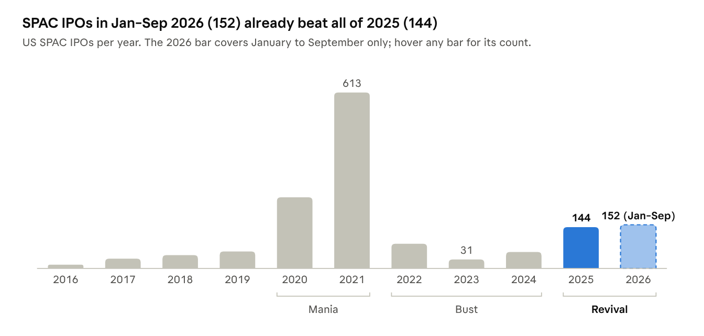
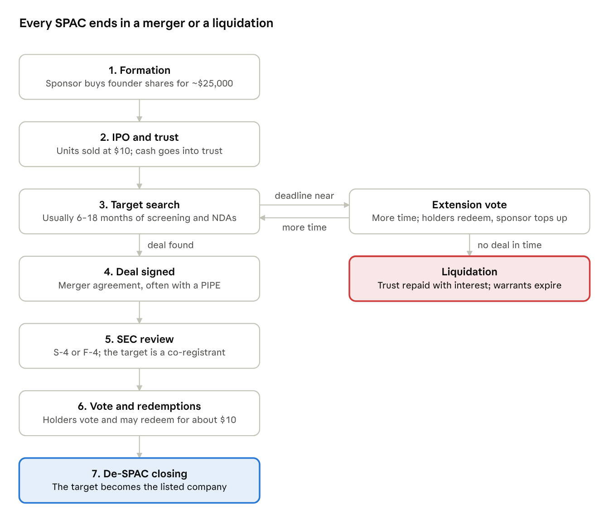

# SPAC 101: History, Rules, Players and Deals

*As of November 6, 2026 · Salahuddin Sirajuddin*

## Start here

**The short answer.** A SPAC (special purpose acquisition company) is a listed pot of cash: a sponsor raises money in an IPO first, locks it in a trust, then has about 2 to 3 years to merge with a private company and take it public. After the 2020–21 frenzy and a 2022–24 bust, SPACs are back: 144 SPAC IPOs raised $30.4 billion in 2025, and 152 more raised about $29.7 billion in January–September 2026.

**Your reading plan** (about 60 minutes end to end):

| Part | What you will understand | Time |
|---|---|---|
| 1. SPACs in 60 seconds | What a SPAC is, in one analogy and one example | 3 min |
| 2. Why SPACs are back | The 2025–26 numbers and the forces behind them | 5 min |
| 3. History | 1980s fraud, the 1993 invention, boom, bust, revival | 6 min |
| 4. Terminology | The terms you will hear in every SPAC conversation | 8 min |
| 5. Lifecycle | Every transaction, step by step, with typical durations | 8 min |
| 6. Who's who | Sponsor, trustee, custodian, underwriters, and who owes fiduciary duties | 7 min |
| 7. Rules | The laws and rules that govern each step | 8 min |
| 8. The money | A worked $200M example: promote, warrants, redemptions, dilution | 6 min |
| 9. Deal examples | The biggest wins, losses and 2025–26 deals, with sizes | 6 min |
| 10. Risks | What goes wrong and why | 3 min |

Short on time? Read parts 1, 2 and 5 (about 16 minutes).

**Next course:** [SPAC 102](../spac-102/course.md) covers what happened to the companies after their mergers: the failures, the survivors and the red flags.

## 1. SPACs in 60 seconds

*Time to understand: 3 minutes*

**A SPAC is a company with no business, only cash and a deadline.** It raises money from public investors first, then shops for one private company to merge with. When that merger closes (the "de-SPAC"), the private company becomes the listed company and takes over the ticker.

**The analogy.** Picture a pre-funded moving truck with an expiry date. Investors load it with cash at $10 a share and lock it in a trust. A driver (the sponsor) has roughly 24 months to find one family (a private company) to move into the public market. If no family is found, the truck is unloaded, everyone gets their cash back with interest, and the driver loses the money spent on gas.

**Why anyone buys a "blank check": three built-in protections.**

1. **Cash in trust.** IPO money sits in short-term US Treasuries or cash, and can leave only for a merger or a refund.
2. **Redemption right.** Before the merger closes, any public shareholder can hand back shares for about $10 plus interest, even if they voted yes.
3. **Deadline.** No deal in time (usually 18 to 36 months) means liquidation and refunds.

**A simple example (illustrative numbers).**

1. Month 0: "Acme Acquisition Corp" sells 20 million units at $10, and $200M goes into trust.
2. The sponsor paid about $25,000 for founder shares that will equal 20% of the company (5 million shares). It also spends about $6M on private warrants to cover fees and running costs.
3. Month 14: Acme signs a merger with RoboCo, a private robotics company valued at $1 billion.
4. Month 18: Shareholders vote. 60% of public shares redeem, so $120M is paid out and $80M stays. Institutions add a $50M PIPE.
5. Closing: RoboCo trades as "ROBO" with about $130M of new cash before fees. RoboCo's owners keep most of the shares; the SPAC holders, sponsor and PIPE investors own the rest.

**SPAC merger vs. traditional IPO**

| Question | Traditional IPO | SPAC merger |
|---|---|---|
| Who sets the price? | Market demand on pricing day | Negotiated with the sponsor, months before closing |
| Can the company show forecasts? | Rarely, for liability reasons | Yes, with extra disclosure and liability since 2024 |
| How certain is the cash? | Depends on the market that week | Depends on how many shareholders redeem |
| Main cost | Underwriting spread, typically 5–7% | 20% sponsor promote, warrants and fees; often far more in total |
| Best for | Large, predictable, profitable companies | Companies with a story to explain, or that want speed and a fixed price |

## 2. Why SPACs are back

*Time to understand: 5 minutes*

**2026 is already the busiest SPAC year since 2021.** Through September, 152 SPACs priced IPOs and raised about $29.7 billion. That passes 2025's full-year count of 144 IPOs, with proceeds within $1 billion of 2025's $30.4 billion ([ICR Q1](https://www.businesswire.com/news/home/20260408073329/en/ICR-the-Leading-SPAC-Communications-and-Advisory-Firm-Publishes-its-April-2026-SPAC-Market-Update-Outlook), [Q2](https://icrinc.com/news-resources/q2-2026-spac-market-update-outlook/), [Q3](https://www.citybiz.co/article/920871/icr-releases-q3-2026-spac-market-update-and-outlook/); [Boardroom Alpha](https://www.boardroomalpha.com/research/daily-spac-update-december-31-2025)). SPACs were 69% of all US IPOs by count in Q1 2026 and 54% in Q2 ([FTI Q1](https://www.fticonsulting.com/insights/reports/ipo-spac-market-update-q1-2026), [FTI Q2](https://www.fticonsulting.com/uk/insights/articles/ipo-spac-market-update-q2-2026)). At the end of 2025, about $35 billion sat in the trusts of SPACs still hunting for a target ([Houlihan Capital](https://www.houlihancapital.com/wp-content/uploads/2026/02/Q4-2025-SPAC-Report-1.pdf)).



*Source: SPACInsider, Dealogic via SIFMA, industry studies via Wikipedia, Boardroom Alpha (2024–25), ICR (2026) · US SPAC IPOs, 2016 to September 2026*

At about 200 a year (198 in the twelve months to September 2026, per ICR), the revival runs at roughly a third of the 2021 peak.

**Six forces behind the comeback**

| Force | What it means in plain English | Evidence |
|---|---|---|
| A friendlier SEC | The regulator wants more companies to go public and is reviewing the strict 2024 SPAC rules | SEC Chair Paul Atkins said in July 2025 he has nothing against SPACs and would revisit the rules ([Gunderson](https://www.gunder.com/en/news-insights/blogs/public-ventures/cnbc-interview-with-sec-chair-make-ipos-great-again-spac-relief-in-focus)) |
| Repeat sponsors | Teams with a track record raise most new SPACs, and investors trust them more | Serial sponsors were 58% of Q1 2026 SPAC IPOs and about 66% in Q3 (ICR) |
| A picky IPO window | Traditional IPOs favor large, proven companies; mid-size growth companies need another door | FTI describes SPACs as filling gaps left by a selective IPO market |
| Hot themes that need cash fast | AI and robotics, quantum computing, power and nuclear, critical minerals, defense tech, crypto | ICR counts about 70 SPACs in the pipeline, concentrated in these sectors |
| Capital is returning | PIPE investors are back and big banks are re-entering | Goldman Sachs underwrote Infinite Eagle, its first SPAC IPO of 2026 (ICR Q3) |
| The 2021 hangover cleared | Most zombie SPACs from the boom have liquidated, leaving a smaller, fresher pool | Liquidations fell from 53 in 2024 to 10 in 2025 (Boardroom Alpha) |

**Why sponsors keep creating SPACs: the payoff is lopsided.** A sponsor typically pays about $25,000 for founder shares worth 20% of the SPAC, plus a few million dollars of at-risk capital for fees and costs. If a deal closes, those shares can be worth tens of millions of dollars even if the stock falls. If no deal closes, the sponsor loses only the at-risk money. Part 8 works through the numbers.

**Why companies choose a SPAC.** They get speed, a price agreed in advance, the ability to share forecasts with investors, and an experienced sponsor on the board. The 2026 deal list leans toward capital-hungry, pre-profit sectors such as quantum, space, batteries and crypto (Part 9).

**The caution flag.** Most shareholders still take their money back before the merger: the median redemption rate was 94.5% in Q4 2025. In Q1 2025 the median de-SPAC fell 57% in its first week of trading; by Q4 2025 the median was roughly flat, at +3% ([Houlihan Capital](https://www.houlihancapital.com/wp-content/uploads/2026/02/Q4-2025-SPAC-Report-1.pdf)). "Back" means busy, not proven.

## 3. History: from penny-stock fraud to today's revival

*Time to understand: 6 minutes*

**SPACs were invented in the early 1990s as a cleaned-up version of a 1980s scam.** Every crash since then has added a new protection, and today's rules are the scar tissue from the 2021 bubble.

| Era | Years | What happened | What it left behind |
|---|---|---|---|
| Blank-check fraud | 1980s | Promoters sold "blind pool" shells with no stated purpose, often as penny stocks | The Penny Stock Reform Act of 1990, then SEC [Rule 419](https://www.mbelr.org/?p=1828) in 1992: escrowed funds, an 80%-of-funds acquisition test, investor reconfirmation, an 18-month limit |
| Invention | 1992–1993 | David Nussbaum of GKN Securities and lawyer David Miller of Graubard Miller designed the "SPAC". It was priced and sized so Rule 419 did not apply, but voluntarily copied its protections ([Corporate Ownership & Control](https://boa.unimib.it/bitstream/10281/246535/1/17_07_2019_Corporate_Ownership.pdf)) | The template still used today: trust account, shareholder vote, deadline. GKN even trademarked the name |
| First wave | 2003–2008 | Revival led by EarlyBirdCapital, GKN's successor. 13 IPOs in 2004 grew to 66 raising $12 billion in 2007, 23% of all US IPOs ([Dealogic via WSJ](https://journalresources.blogspot.com/2007/12/blank-checks-generate-new-interest.html)) | AMEX began listing SPACs in 2005 ([Mondaq](https://www.mondaq.com/unitedstates/corporate-governance/41456/the-spac-phenomenon-a-discussion-of-the-background-structure-and-recent-developments-involving-special-purpose-acquisition-companies)); NYSE and Nasdaq followed in 2008 |
| Crash | 2008–2009 | The financial crisis froze deals. In 2009 there was a single SPAC IPO, for $36 million | Older SPACs needed about 80% shareholder approval ([Wikipedia](https://en.wikipedia.org/wiki/Special-purpose_acquisition_company)); later structures dropped that and made redemption the main exit |
| Institutional era | 2010–2019 | Bigger, better-known sponsors and banks. 2018 was the biggest year since 2007 (46 IPOs, $10.7 billion); 2019 hit 59 IPOs and $13.6 billion | SPACs became a mainstream route to market |
| Mania | 2020–2021 | Near-zero rates, stimulus and retail trading: 248 IPOs in 2020 and 613 in 2021 (about $162 billion). Grab's $39.6 billion merger with Altimeter became the largest ever | Celebrity sponsors, $4 billion Pershing Square Tontine (the largest SPAC IPO), and an April 2021 SEC accounting statement that forced warrant restatements |
| Bust | 2022–2024 | Rising rates, poor post-merger returns, lawsuits and an SEC crackdown. IPOs fell to 31 in 2023. Of about 1,300 SPACs listed since 2020, 37% have liquidated ([Boardroom Alpha](https://www.boardroomalpha.com/?p=19532)) | The 2024 SEC SPAC rules, the Delaware MultiPlan ruling, hard 36-month exchange deadlines, and a 1% excise tax on US-company redemptions |
| Revival | 2025–2026 | Serial sponsors, leaner warrant packages (about 0.28 warrants per unit in Q2 2025, per [Houlihan Capital](https://www.houlihancapital.com/wp-content/uploads/2025/09/Houlihan-Capital-Q2-2025-SPAC-Report.pdf)) and thematic deals in crypto, quantum, AI and energy. 144 IPOs in 2025; 152 in January–September 2026 | A higher-disclosure regime and a friendlier SEC tone |

**The pattern to remember:** SPAC booms track cheap money and hot themes. Each bust ends with new investor protections, and the next wave is built on top of them.

## 4. Terminology cheat sheet

*Time to understand: 8 minutes. Terms are listed in the order you meet them in a SPAC's life.*

| Term | Plain English | Example or typical number |
|---|---|---|
| SPAC / blank-check company | A listed shell with cash and a deadline, no business | "Acme Acquisition Corp" |
| Sponsor | The team that forms and runs the SPAC; the originator | A PE firm, a bank's SPAC unit, an operator |
| Serial sponsor | A sponsor on its second, third or tenth SPAC | Cantor's "Cantor Equity Partners" series |
| Unit | What IPO investors buy: one share plus a slice of a warrant or a right | $10.00 per unit |
| Class A (public) shares | The shares sold to the public; they carry the redemption right | 20 million shares in a $200M SPAC |
| Founder shares / promote | Class B shares the sponsor buys for almost nothing; they become 20% of the SPAC | About $25,000 for 5 million shares |
| At-risk capital | Cash the sponsor puts in (usually via private warrants) to pay fees and costs; lost if no deal | Often a few million dollars |
| Warrant | A right to buy one share later at a fixed price, usually $11.50 | Half or a third of a warrant per unit |
| Right | A ticket that converts into a fraction of a share at the merger, no payment needed | 1/10 of a share per right |
| Trust account | The locked account holding IPO cash in short-term Treasuries or cash | $10.00–$10.20 per share |
| Over-allotment (greenshoe) | Underwriters' option to sell up to 15% more units | $200M becomes $230M |
| Underwriting discount | Bank fee, split into an upfront part and a deferred part paid only if a merger closes | Commonly 2% upfront plus 3.5% deferred |
| Deadline / combination period | Time allowed to complete a merger, set in the charter | 18–24 months; exchange maximum 36 months |
| Target | The private company the SPAC wants to merge with | RoboCo |
| 80% test | Exchange rule: the target must be worth at least 80% of the trust | $160M+ for a $200M trust |
| Letter of intent (LOI) | Non-binding term sheet with the target | Valuation, exclusivity period |
| Business combination agreement (BCA) | The binding merger contract | Signed and announced with a press release and investor deck |
| PIPE | Private investment in public equity: institutions buy shares at closing to add cash | $50M at $10 per share |
| Forward purchase / non-redemption agreement | Deals with investors to buy shares or not redeem, often paid with sponsor shares | Sponsor gives up 1 share per 4 kept |
| Form S-4 / F-4 | Registration statement and proxy for the merger, reviewed by the SEC | 300+ pages |
| Co-registrant | Since July 2024, the target also signs the S-4/F-4 and is liable for it | RoboCo's CEO and CFO sign |
| Redemption | A public holder hands back shares for their share of the trust before closing | $10.30 per share including interest |
| Redemption rate | Share of public stock redeemed | Median about 95% in late 2025 |
| Extension | Shareholder vote to push the deadline, usually with redemptions and sponsor top-ups | +6 months, sponsor adds cash per share |
| De-SPAC | The merger closing; the target becomes the public company | Ticker changes from ACME to ROBO |
| Earnout | Extra shares paid later only if the stock hits price targets | At $12.50 and $15.00 |
| Lock-up | Period when insiders cannot sell | 6–12 months |
| Super 8-K | The filing within 4 business days after closing with full company information | Form 10-level disclosure |
| Net cash per share | The cash really delivered per share after redemptions, fees and dilution | Median $5.70 in 2019–20 mergers ([Klausner et al.](https://www.ecgi.global/working-paper/sober-look-spacs)) |
| Liquidation | No deal by the deadline: trust returned, warrants expire worthless | Holders get about $10 plus interest |
| Sponsor handover | The sponsor sells its stake and control to a new sponsor | Purchase and Sponsor Handover Agreement |
| SPAC arbitrage | Funds buy units at IPO, keep the warrants or rights, redeem shares for cash | A Treasury-like return plus a free option |

## 5. The SPAC lifecycle, step by step

*Time to understand: 8 minutes*

**A SPAC lives about 2 to 3 years and has two possible endings: a merger (the de-SPAC) or a liquidation.** Each step below is a separate transaction with its own documents, parties and deadlines. That is why the process is so paperwork-heavy, and why so much of it can be handed to software.



A sponsor handover (row C in the table below) is a third way out when a SPAC nears its deadline without a deal.

| # | Step | What happens | Key documents | Who is involved | Typical timing |
|---|---|---|---|---|---|
| 1 | Formation | Sponsor sets up the SPAC, usually as a Cayman Islands or Delaware company, and buys founder shares | Charter, founder share purchase, insider letter agreement | Sponsor, lawyers, auditor | A few weeks |
| 2 | IPO registration | SPAC files with the SEC and answers its comments | Form S-1 with the 2024 SPAC disclosures, underwriting agreement | SEC, underwriters, counsel, auditor | 2–4 months |
| 3 | IPO and trust funding | Units sell at $10; cash goes into trust; sponsor buys private warrants to pay fees | Investment management trust agreement, warrant agreement | Underwriters, trustee, custodian bank, IPO investors (mostly arbitrage funds) | 1 day |
| 4 | Unit split | Units separate into shares and warrants or rights that trade on their own | Press release | Exchange, transfer agent | About 52 days after IPO |
| 5 | Target search | Sponsor screens companies, signs NDAs and letters of intent | NDAs, LOIs, diligence lists | Sponsor, bankers, founders, VC and PE owners | Often 6–18 months |
| 6 | Deal signing | Merger terms agreed; sponsor support, lock-ups and earnouts set; a PIPE is often signed at the same time | Business combination agreement, PIPE subscription agreements, investor deck | Both boards, advisors, PIPE investors | 2–4 months of negotiation |
| 7 | SEC review | Registration statement filed with the target as co-registrant; rounds of SEC comments | Form S-4 or F-4, comment letters | SEC, counsel, auditors (PCAOB audit of the target) | Often 3–6 months |
| 8 | Vote and redemptions | Proxy mailed at least 20 days before the vote; holders vote and can redeem | Definitive proxy, redemption notices | Shareholders, proxy solicitor, transfer agent, trustee | 20+ days |
| 9 | Closing (de-SPAC) | Trust released net of redemptions; PIPE cash arrives; deferred fees paid; ticker changes | Funds-flow memo, Super 8-K within 4 business days | Trustee, exchange, transfer agent | 1–2 days |
| 10 | After closing | Lock-ups expire, earnouts vest, warrants become exercisable and may be called; normal public-company reporting | 10-Q and 10-K, resale registration | New management, investor relations, auditors | 6–12 months |
| A | Extension | If time runs short, holders vote to extend; many redeem; the sponsor may top up the trust | Extension proxy, trust deposit letters | Sponsor, shareholders, trustee | Before each deadline |
| B | Liquidation | No deal by the deadline: trust paid out, warrants expire worthless, the SPAC dissolves | Termination letter to the trustee | Trustee, exchange | At the deadline |
| C | Sponsor handover | The old sponsor sells control to a new sponsor who tries to finish a deal | Purchase and sponsor handover agreement ([example](https://www.lawinsider.com/contracts/6YrougQtsyA)) | Old and new sponsors, shareholders | Any time before a deal |

Timings are typical ranges, not rules. The hard limits are the charter deadline and the exchange's 36-month cap.

## 6. Who's who: the cast, and who owes fiduciary duties

*Time to understand: 7 minutes*

**Only the SPAC's directors, and in Delaware a controlling sponsor, owe fiduciary duties to SPAC shareholders.** Everyone else owes contractual duties or carries securities-law liability, which is a different thing. Delaware's 2022 *MultiPlan* ruling made this concrete. The court applied its strictest "entire fairness" review to a de-SPAC because of sponsor conflicts, and held that directors owe shareholders full disclosure before they decide whether to redeem ([Dechert](https://www.dechert.com/knowledge/onpoint/2022/1/delaware-court-of-chancery-issues---first-decision-addressing-di.html)).

**Trustee vs. custodian, in one line.** The trustee, almost always Continental Stock Transfer & Trust, is legally responsible for following the trust agreement. The custodian bank, typically JPMorgan Chase Bank or another US bank with $100 billion+ in assets, is where the money physically sits ([sample trust agreement](https://www.sec.gov/Archives/edgar/data/1821169/000121390021016281/fs12021a4ex10-3_global.htm)). The trust may hold only Treasuries maturing in 185 days or less, Treasury money-market funds, or (in newer deals) bank deposits.

| Role | What they do | Duty owed | How they are paid | Examples |
|---|---|---|---|---|
| Sponsor (the originator) | Forms the SPAC, funds its costs, finds the target, negotiates the deal | Fiduciary duties if it controls a Delaware SPAC (MultiPlan); contractual promises in insider letters | Founder shares (the 20% promote) and private warrants | [Cantor Equity Partners](https://www.bankless.com/read/news/tether-backed-twenty-one-completes-spac-merger-with-cantor-equity-partners.md) series; Ares Acquisition Corp II |
| SPAC board and officers | Approve the deal, oversee disclosure, decide whether it is in shareholders' interest | Fiduciary duties of care and loyalty, including full disclosure before redemptions | Usually economic interests in founder shares | Independent directors on the audit committee |
| IPO underwriters | Sell the units; often advise on the merger | Securities-law liability for the prospectus; no fiduciary duty to investors | Commonly 2% at IPO plus about 3.5% deferred, paid only if a deal closes | Cantor led the 2019 league table; Goldman Sachs returned in 2026 with Infinite Eagle |
| Trustee | Holds the trust, invests only as allowed, releases cash only on valid written instructions | Contractual, under the investment management trust agreement | Fixed fees | Continental Stock Transfer & Trust |
| Custodian bank | Bank where the trust account physically sits | Safekeeping, under the trust agreement | Bank fees and balances | JPMorgan Chase Bank, N.A. |
| Transfer and warrant agent | Keeps the shareholder register, processes redemptions and warrant exercises | Contractual | Fees | Usually Continental again |
| Auditor | Audits the SPAC and, with PCAOB standards, the target | Professional standards under SEC and PCAOB oversight | Fees | Withum audited 68% of SPAC IPOs in Q2 2025 ([Ideagen](https://www.ideagen.com/thought-leadership/blog/ipo-trends-q2-2025)) |
| Legal counsel | Drafts the S-1, BCA and S-4; runs the SEC process | Duty to its own client | Fees | Kirkland & Ellis for Ares on Kodiak ([Lawyer Monthly](https://www.lawyer-monthly.com/2025/04/kirkland-kodiak-spac-autonomous-trucking/)) |
| Financial advisors and PIPE placement agents | Value the target, raise the PIPE, sometimes give a fairness opinion | Possible "statutory underwriter" liability in the de-SPAC under SEC guidance; must be registered broker-dealers to place securities | Advisory and placement fees | Citigroup and J.P. Morgan on Kodiak's PIPE ([Ropes & Gray](https://www.ropesgray.com/en/news-and-events/news/2025/09/ropes-gray-advised-on-ares-acquisition-corporation-ii-business-combination-with-kodiak-robotics)) |
| PIPE and forward-purchase investors | Commit cash at closing | None; they are investors | Shares, sometimes with sweeteners | Soros Fund Management and ARK in Kodiak |
| Public holders and arbitrage funds | Buy units, vote, often redeem | None | Trust yield plus warrants or rights | The close-knit hedge funds long nicknamed the "SPAC Mafia" |
| Target company and its board | Merges in; since July 2024 co-signs the S-4/F-4 | Fiduciary duties to its own shareholders; Section 11 liability as co-registrant | Equity in the combined company | RoboCo in our example |
| Investor relations and proxy firms | Find holders, win votes, reduce redemptions | Contractual | Fees | ICR has advised on 180+ SPAC deals since 2021 |
| Stock exchange | Lists the SPAC; enforces the deadline and the 80% test | Self-regulatory organization | Listing fees | Nasdaq, NYSE, NYSE American |
| SEC | Reviews filings; enforces disclosure and fraud rules | Regulator | None | Division of Corporation Finance; Enforcement Division |

## 7. Rules and regulations

*Time to understand: 8 minutes*

**SPACs sit under four layers of rules: federal securities law, the SEC's 2024 SPAC rules, stock-exchange listing rules, and the corporate law of where the SPAC is incorporated.**

| Layer | Rule | What it requires, in plain English |
|---|---|---|
| Federal law | Securities Act of 1933 | Register securities before selling them (S-1 for the IPO, S-4 or F-4 for the merger). Signers are liable for misstatements under Section 11 |
| Federal law | Securities Exchange Act of 1934 | Ongoing reports (10-K, 10-Q, 8-K), proxy and tender-offer rules, and broker-dealer registration under Section 15(a) |
| SEC SPAC rules (adopted January 24, 2024; effective July 1, 2024) | Subpart 1600 of Regulation S-K | Detailed disclosure of sponsor pay, conflicts of interest, dilution at different redemption levels, and the board's view of the deal |
| SEC SPAC rules | Co-registrant rule and Rule 145a | The target signs the S-4/F-4 and is liable for it; the merger counts as a sale of securities to SPAC holders ([Pillsbury](https://pillsburylaw.com/en/news-and-insights/sec-spacs-final-rules.html)) |
| SEC SPAC rules | No PSLRA safe harbor | Forecasts in de-SPAC filings lose the safe harbor for forward-looking statements, and their assumptions must be explained |
| SEC SPAC rules | 20-day minimum | The proxy must reach holders at least 20 calendar days before the vote |
| SEC SPAC rules | Inline XBRL tagging | The new SPAC disclosures must be machine-tagged in filings from June 30, 2025 ([PwC](https://viewpoint.pwc.com/dt/us/en/pwc/in_briefs/2024/2024-in-brief/ib202401.html)) |
| SEC SPAC rules | Guidance, not rules | When a SPAC may be an unregistered investment company, and when deal participants may be "statutory underwriters". The SEC dropped its proposed safe harbors ([Gibson Dunn](https://www.gibsondunn.com/wp-content/uploads/2024/02/sec-adopts-final-rules-to-align-spacs-more-closely-with-ipos.pdf)) |
| Federal law | Investment Company Act of 1940 | A SPAC that behaves like a fund risks being an unregistered investment company; 2021 lawsuits made this argument |
| Exchange rules | Nasdaq IM-5101-2, NYSE 102.06, NYSE American 119 | Merge within 36 months or face suspension and delisting; the target must be worth at least 80% of the trust; at least 90% of IPO proceeds held in trust ([NYSE filing](https://www.sec.gov/files/rules/sro/nyse/2024/34-99906.pdf)) |
| Corporate law | Delaware | Directors and controlling sponsors owe fiduciary duties. *MultiPlan* (2022) and *GigAcquisitions3* (2023) applied entire-fairness review to conflicted de-SPACs |
| Corporate law | Cayman Islands | Most new SPACs are Cayman exempted companies: 103 had listed in the US in 2026 at the time of a [Cayman Finance count](https://www.crowdfundinsider.com/?p=286214) |
| Tax | Inflation Reduction Act of 2022 | A 1% excise tax on share repurchases, including redemptions, by US companies from 2023. Cayman SPACs are not expected to be covered unless they become US companies first ([sample S-1](https://www.sec.gov/Archives/edgar/data/2053927/000182912625002984/wintergreenacq_s1.htm)) |
| Accounting | SEC staff statement, April 2021 | Many SPAC warrants must be booked as liabilities; hundreds of restatements followed |
| Broker-dealer law | M&A broker exemption, Exchange Act 15(b)(13), effective March 2023 | Lets unregistered M&A brokers earn deal fees, but not on transactions involving shell companies such as SPACs ([ACG](https://www.acg.org/sites/files/2023-05/Congress%20Codifies%20M%26A%20Broker%20Exemption%20Presentation.pdf)) |
| Enforcement | SEC actions | Nikola paid $125M (2021); Akazoo $38.8M; Momentus $7M plus $1M from its SPAC, Stable Road, for weak due diligence; Digital World $18M (2023) ([Compliance Week](https://complianceweek.com/spac/9370.tag)) |

**Where the SEC stands now.** In July 2025, SEC Chair Paul Atkins called the 2024 rules "rather controversial" and said the agency would review them ([Bloomberg Law](https://news.bloomberglaw.com/mergers-and-acquisitions/secs-atkins-says-agency-will-look-at-rules-on-blank-check-firms)). As of June 2026, deals were still being done under the 2024 framework ([Mayer Brown](https://www.freewritings.law/2026/06/the-resurgence-of-spacs-key-trends-market-data-and-whats-ahead/)). I found no final rollback as of this writing, so check the SEC's rulemaking agenda before relying on any change.

## 8. The money: a worked $200 million example

*Time to understand: 6 minutes*

**In a SPAC, the sponsor can make several times its money even when public shareholders lose.** Here is a simplified $200 million SPAC with round, illustrative numbers.

**Setup at the IPO**

- Public: 20,000,000 units at $10 = $200M, all into trust. Each unit holds one share and half a warrant, so there are 10,000,000 public warrants with an $11.50 strike.
- Sponsor: 5,000,000 founder shares for $25,000, which is 20% of the 25,000,000 shares outstanding. It also buys 6,000,000 private warrants at $1.00, or $6,000,000.
- The sponsor's $6M pays the 2% upfront underwriting fee ($4M) and about $2M of IPO and running costs. The 3.5% deferred fee ($7M) is owed only if a merger closes.
- By the vote, interest has lifted the trust to about $10.30 a share, or $206M.

**The deal: merge with RoboCo at a $1 billion valuation (100,000,000 new shares at $10)**

1. 90% of public shares redeem: 18,000,000 × $10.30 = $185.4M leaves the trust. 2,000,000 public shares stay, backed by $20.6M.
2. A PIPE adds $50M for 5,000,000 new shares at $10.
3. Deal costs, including the $7M deferred fee, come to about $15M.
4. Cash into the company: $20.6M + $50M − $15M = $55.6M.

**Who owns the 112,000,000 shares after closing**

| Holder | Shares | Ownership | Paid per share |
|---|---|---|---|
| RoboCo's existing owners | 100,000,000 | 89.3% | Contributed the company |
| Sponsor | 5,000,000 | 4.5% | $0.005, plus $6M at risk |
| PIPE investors | 5,000,000 | 4.5% | $10.00 |
| Public holders who stayed | 2,000,000 | 1.8% | Gave up $10.30 in cash |

On top of that sit 16,000,000 warrants at $11.50, which dilute further if the stock rises.

**Net cash per share: the number that tells the truth.** Every SPAC-side share is counted at $10 in the deal, but the cash behind it is much lower:

```latex
\text{Net cash per share} = \frac{\text{Trust cash left} + \text{PIPE} - \text{Deal costs}}{\text{Public shares left} + \text{Sponsor shares} + \text{PIPE shares}} = \frac{20.6 + 50 - 15}{2 + 5 + 5} \approx 4.63
```

So each SPAC-side share brings about $4.63 of cash, not $10. Research on real deals found the same pattern: a median of $5.70 of net cash per share in 2019–20 mergers, and lower net cash went with weaker post-merger prices ([Klausner, Ohlrogge and Ruan](https://www.ecgi.global/working-paper/sober-look-spacs)).

**Who wins in each ending**

| Party | Puts in | Deal closes, stock at $10 | Deal closes, stock falls to $5 | No deal (liquidation) |
|---|---|---|---|---|
| Sponsor | $6.025M | 5M shares worth $50M, about 8.3x | $25M, about 4.1x | Loses $6.025M |
| Public holder who redeemed | $10 per unit | $10.30 back plus a free half-warrant | Same | $10.30 back |
| Public holder who stayed | Gave up $10.30 | Share worth $10 | Share worth $5 | $10.30 back |
| Underwriters | Their work | $4M plus $7M | $4M plus $7M | $4M only |
| RoboCo's owners | Their company | 89.3% of a listed company with $55.6M of new cash | Same stake at a lower price | Stay private |

The sponsor breaks even if the stock stays above about $1.21 ($6.025M ÷ 5M shares). A public holder who stayed needs more than $10.30 just to beat redeeming. That gap is the core conflict the 2024 rules force SPACs to disclose, including dilution tables at several redemption levels.

**A real-deal check.** When Ares Acquisition Corp II agreed to merge with Kodiak in April 2025, its trust held about $551M ([Lawyer Monthly](https://www.lawyer-monthly.com/2025/04/kirkland-kodiak-spac-autonomous-trucking/)). At closing in September, about $62.9M of trust cash remained, and a $145M PIPE did the heavy lifting ([Kodiak release](https://www-web.itiger.com/news/2570080516)). Roughly 11% of the trust money stayed.

## 9. Deal examples and sizes

*Time to understand: 6 minutes*

**SPAC IPOs usually raise $150–300 million, and the companies they merge with are usually worth several times the trust.** The median SPAC IPO was $200M in Q4 2025 ([Houlihan Capital](https://www.houlihancapital.com/wp-content/uploads/2026/02/Q4-2025-SPAC-Report-1.pdf)), and 73% of Q2 2025 SPAC IPOs were $200M or larger ([SPACInsider](https://old.spacinsider.com/wp-content/uploads/2025/07/Q2-H1-2025-SPAC-Review-Final1.pdf)). In 2026, through June 22, 20 de-SPACs closed with a combined value above $25 billion, and 110 more were pending ([Mayer Brown](https://www.freewritings.law/2026/06/the-resurgence-of-spacs-key-trends-market-data-and-whats-ahead/)).

**The record-setters**

| Deal | Year | Size | What happened |
|---|---|---|---|
| Grab + Altimeter Growth Corp | 2021 | $39.6B valuation | The largest SPAC merger ever ([DealStreetAsia](https://dealstreetasia.com/?p=236339)) |
| Lucid Motors + Churchill Capital Corp IV | 2021 | $24B pro forma equity value; $2.5B PIPE at $15 a share | A record PIPE, priced 50% above trust value ([The National](https://www.pressreader.com/uae/the-national-news/20210224/281788516779524)) |
| Trump Media + Digital World Acquisition Corp | 2024 | About $7.9B market value after closing ([Bloomberg](https://www.bloomberg.com/news/articles/2024-03-26/trump-social-media-firm-gains-20-ahead-of-post-spac-deal-debut)) | Only 4,939 shares were redeemed ([Trump Media S-1](https://www.sec.gov/Archives/edgar/data/1849635/000114036124019745/ny20026576x1_s1.htm)); the SPAC had paid an $18M SEC settlement |
| Pershing Square Tontine (Bill Ackman) | 2020–22 | $4.0B IPO, the largest ever | No deal closed; it liquidated in July 2022, returning about $20.05 per $20 unit ([Renaissance Capital](https://www.renaissancecapital.com/IPO-Center/News/93588/Bill-Ackmans-Pershing-Square-Tontine-the-largest-ever-SPAC-IPO-plans-to-liq)) |
| Nikola + VectoIQ | 2020 | $3.3B | Paid a $125M SEC fraud settlement in 2021 ([A&O Shearman](https://www.lit-wc.aoshearman.com/company-acquired-by-spac-agrees-to-pay-125-million-to-settle-sec-probe)) |

**Recent deals, newest first**

| Company + SPAC | Closed | Size | Detail |
|---|---|---|---|
| Factorial Energy + Cartesian Growth Corp III | June 2026 | $1.3B | Solid-state batteries; raised over $100M ([Just Auto](https://www.just-auto.com/newsletters/factorial-energy-goes-public-1-3bn-valuation)) |
| Einride + Legato Merger Corp III | 2026 | $1.35B pre-money | Valuation cut from $1.8B at announcement in November 2025 ([Crypto Briefing](https://cryptobriefing.com/einride-nasdaq-debut-spac-merger-2/)) |
| CoinShares + Vine Hill Capital Investment Corp | April 2026 | $1.2B | A European crypto asset manager moved its listing to Nasdaq ([The Block](https://theblock.co/post/396021/coinshares-enters-us-public-markets-via-nasdaq-after-1-2-billion-vine-hill-spac-merger)) |
| Twenty One Capital + Cantor Equity Partners | December 2025 | $3.6B at announcement ([Tiger/MT Newswires](https://www-web.itiger.com/news/2529771638)) | Bitcoin treasury company; fell nearly 20% on its NYSE debut ([HODL FM](https://news.hodlfm.io/market/twenty-one-capital-stock-fell)) |
| Kodiak AI + Ares Acquisition Corp II | September 2025 | $2.5B pre-money | Autonomous trucks; a $145M PIPE did most of the funding ([Kodiak release](https://www-web.itiger.com/news/2570080516)) |
| Webull + SK Growth Opportunities | April 2025 | $7.3B | Up 124% a week after closing ([FinTech Futures](https://www.fintechfutures.com/stock-exchange-ipos/webull-goes-public-on-nasdaq-following-spac-merger), [Houlihan Capital](https://www.houlihancapital.com/wp-content/uploads/2025/09/Houlihan-Capital-Q2-2025-SPAC-Report.pdf)) |

**Still pending:** nuclear-reactor startup Newcleo, valued at about $2.4B before new money and expected to close in the second half of 2026 ([JBiz News](https://jbiznews.com/?p=388313)). Two 2025 deals, Kyivstar and BridgeBio Oncology Therapeutics, closed with redemptions under 40%, far below the 90%+ norm ([Renaissance Capital](https://www.renaissancecapital.com/IPO-Center/News/112903/two-de-spacs-defy-trends-to-raise-100-million-with-low-redemptions)).

**What the list tells you:** the winners had real revenue or a hot theme plus committed PIPE money. Many others lost value soon after closing (Part 10).

## 10. Risks and criticisms

*Time to understand: 3 minutes*

**Most SPAC risks are information problems: hidden dilution, unpredictable redemptions, unverified claims and deadline pressure.** That is bad news for investors and good news for anyone building tools to measure them.

| Risk | What goes wrong | Real example |
|---|---|---|
| Dilution | The promote, warrants and fees leave far less than $10 of cash behind each share | Median net cash of $5.70 a share in 2019–20 mergers (Part 8) |
| Redemptions drain the cash | Most holders take their money back, so the company gets much less than planned | Hadron Energy closed in May 2026 after 84% of public shares redeemed, removing $180M ([Panabee](https://www.panabee.com/news/hadron-energy-completes-business-combination-amidst-84-redemption-rate)) |
| Weak trading after closing | Many de-SPACs fall below $10 within days | Median first-week return of −57% in Q1 2025 and −23% in Q3 2025 ([Houlihan Capital](https://www.houlihancapital.com/wp-content/uploads/2025/12/Q3-2025-SPAC-Report.pdf)) |
| Hype and fraud | Forecasts and product claims outrun reality | Nikola's $125M SEC penalty; Akazoo's $38.8M |
| Conflicts and lawsuits | The sponsor can profit from a bad deal, so shareholders sue | *MultiPlan* (2022) and *GigAcquisitions3* (2023) in Delaware |
| Deadline pressure | Sponsors rush deals or extend again and again | 37% of SPACs listed since 2020 have liquidated |
| Valuation resets | Terms get cut before closing when markets move | Einride: $1.8B at announcement, $1.35B at closing |
| Rule changes | Rules can tighten or loosen fast | The 2024 rules have been under SEC review since 2025 |

**What happened after the mergers** (the scorecard, the biggest collapses, the survivors and a red-flag checklist) is covered in [SPAC 102](../spac-102/course.md).

## Sources

**Market data**

- [ICR, April 2026 SPAC Market Update (Q1 2026)](https://www.businesswire.com/news/home/20260408073329/en/ICR-the-Leading-SPAC-Communications-and-Advisory-Firm-Publishes-its-April-2026-SPAC-Market-Update-Outlook)
- [ICR, Q2 2026 SPAC Market Update](https://icrinc.com/news-resources/q2-2026-spac-market-update-outlook/)
- [ICR, Q3 2026 SPAC Market Update (via Citybiz)](https://www.citybiz.co/article/920871/icr-releases-q3-2026-spac-market-update-and-outlook/)
- [Boardroom Alpha, Daily SPAC Update, December 31, 2025](https://www.boardroomalpha.com/research/daily-spac-update-december-31-2025)
- [Boardroom Alpha, SPAC statistics](https://www.boardroomalpha.com/?p=19532)
- [FTI Consulting, IPO & SPAC Market Update Q1 2026](https://www.fticonsulting.com/insights/reports/ipo-spac-market-update-q1-2026)
- [FTI Consulting, IPO & SPAC Market Update Q2 2026](https://www.fticonsulting.com/uk/insights/articles/ipo-spac-market-update-q2-2026)
- [Houlihan Capital, Q4 2025 SPAC Report](https://www.houlihancapital.com/wp-content/uploads/2026/02/Q4-2025-SPAC-Report-1.pdf), [Q3 2025](https://www.houlihancapital.com/wp-content/uploads/2025/12/Q3-2025-SPAC-Report.pdf), [Q2 2025](https://www.houlihancapital.com/wp-content/uploads/2025/09/Houlihan-Capital-Q2-2025-SPAC-Report.pdf), [Q1 2025](https://www.houlihancapital.com/wp-content/uploads/2025/05/Q1-2025-SPAC-Report.pdf)
- [Mayer Brown, The resurgence of SPACs (June 2026)](https://www.freewritings.law/2026/06/the-resurgence-of-spacs-key-trends-market-data-and-whats-ahead/)
- [SPACInsider, Q2/H1 2025 SPAC Review](https://old.spacinsider.com/wp-content/uploads/2025/07/Q2-H1-2025-SPAC-Review-Final1.pdf); [SPACs 2017 vs. 2018](https://www.spacinsider.com/news/spacinsider/spacs-2017-vs-2018)
- [Cayman Finance count, via Crowdfund Insider](https://www.crowdfundinsider.com/?p=286214)
- [SIFMA Insights, SPACs vs. IPOs (2021)](https://www.sifma.org/wp-content/uploads/2021/03/SIFMA-Insights-Spotlight-SPACs-vs-IPOs-FOR-WEB.pdf)
- [Wikipedia, Special-purpose acquisition company](https://en.wikipedia.org/wiki/Special-purpose_acquisition_company); [SPACInsider data cited in a 2021 thesis](https://core.ac.uk/download/427316473.pdf)

**History**

- [Michigan Business & Entrepreneurial Law Review, SPAC history](https://www.mbelr.org/?p=1828)
- [Corporate Ownership & Control, 2019](https://boa.unimib.it/bitstream/10281/246535/1/17_07_2019_Corporate_Ownership.pdf)
- [WSJ via Dealogic, 2007 SPAC volume](https://journalresources.blogspot.com/2007/12/blank-checks-generate-new-interest.html); [2004–2006 volume](https://spactalk.blogspot.com/2007/05/blank-check-firms-gain-favor.html)
- [Mondaq, The SPAC phenomenon (2006)](https://www.mondaq.com/unitedstates/corporate-governance/41456/the-spac-phenomenon-a-discussion-of-the-background-structure-and-recent-developments-involving-special-purpose-acquisition-companies)

**Rules, law and research**

- [Pillsbury, SEC final SPAC rules](https://pillsburylaw.com/en/news-and-insights/sec-spacs-final-rules.html); [PwC Viewpoint](https://viewpoint.pwc.com/dt/us/en/pwc/in_briefs/2024/2024-in-brief/ib202401.html); [Gibson Dunn](https://www.gibsondunn.com/wp-content/uploads/2024/02/sec-adopts-final-rules-to-align-spacs-more-closely-with-ipos.pdf)
- [NYSE rule filing on SPAC deadlines](https://www.sec.gov/files/rules/sro/nyse/2024/34-99906.pdf)
- [Gunderson Dettmer on Chair Atkins's CNBC interview](https://www.gunder.com/en/news-insights/blogs/public-ventures/cnbc-interview-with-sec-chair-make-ipos-great-again-spac-relief-in-focus); [Bloomberg Law](https://news.bloomberglaw.com/mergers-and-acquisitions/secs-atkins-says-agency-will-look-at-rules-on-blank-check-firms)
- [Dechert on In re MultiPlan](https://www.dechert.com/knowledge/onpoint/2022/1/delaware-court-of-chancery-issues---first-decision-addressing-di.html)
- [ACG Detroit, M&A broker exemption](https://www.acg.org/sites/files/2023-05/Congress%20Codifies%20M%26A%20Broker%20Exemption%20Presentation.pdf)
- [Compliance Week, SPAC enforcement](https://complianceweek.com/spac/9370.tag)
- [Sample investment management trust agreement (SEC filing)](https://www.sec.gov/Archives/edgar/data/1821169/000121390021016281/fs12021a4ex10-3_global.htm); [sample S-1 risk factors on the excise tax](https://www.sec.gov/Archives/edgar/data/2053927/000182912625002984/wintergreenacq_s1.htm)
- [Klausner, Ohlrogge and Ruan, A Sober Look at SPACs](https://www.ecgi.global/working-paper/sober-look-spacs)

**Deals**

- [DealStreetAsia on Grab](https://dealstreetasia.com/?p=236339); [The National on Lucid](https://www.pressreader.com/uae/the-national-news/20210224/281788516779524); [Bloomberg on Trump Media](https://www.bloomberg.com/news/articles/2024-03-26/trump-social-media-firm-gains-20-ahead-of-post-spac-deal-debut); [Trump Media S-1](https://www.sec.gov/Archives/edgar/data/1849635/000114036124019745/ny20026576x1_s1.htm)
- [Renaissance Capital on Pershing Square Tontine](https://www.renaissancecapital.com/IPO-Center/News/93588/Bill-Ackmans-Pershing-Square-Tontine-the-largest-ever-SPAC-IPO-plans-to-liq); [A&O Shearman on Nikola](https://www.lit-wc.aoshearman.com/company-acquired-by-spac-agrees-to-pay-125-million-to-settle-sec-probe)
- [Just Auto on Factorial](https://www.just-auto.com/newsletters/factorial-energy-goes-public-1-3bn-valuation); [Crypto Briefing on Einride](https://cryptobriefing.com/einride-nasdaq-debut-spac-merger-2/); [The Block on CoinShares](https://theblock.co/post/396021/coinshares-enters-us-public-markets-via-nasdaq-after-1-2-billion-vine-hill-spac-merger)
- [MT Newswires on Twenty One](https://www-web.itiger.com/news/2529771638); [HODL FM on the XXI debut](https://news.hodlfm.io/market/twenty-one-capital-stock-fell)
- [Kodiak closing release](https://www-web.itiger.com/news/2570080516); [Lawyer Monthly on Kodiak](https://www.lawyer-monthly.com/2025/04/kirkland-kodiak-spac-autonomous-trucking/); [Ropes & Gray on Kodiak](https://www.ropesgray.com/en/news-and-events/news/2025/09/ropes-gray-advised-on-ares-acquisition-corporation-ii-business-combination-with-kodiak-robotics)
- [FinTech Futures on Webull](https://www.fintechfutures.com/stock-exchange-ipos/webull-goes-public-on-nasdaq-following-spac-merger); [JBiz News on Newcleo](https://jbiznews.com/?p=388313); [Renaissance Capital on low-redemption deals](https://www.renaissancecapital.com/IPO-Center/News/112903/two-de-spacs-defy-trends-to-raise-100-million-with-low-redemptions); [Panabee on Hadron Energy](https://www.panabee.com/news/hadron-energy-completes-business-combination-amidst-84-redemption-rate)

**Players and documents**

- [Ideagen, Q2 2025 IPO trends (Withum share)](https://www.ideagen.com/thought-leadership/blog/ipo-trends-q2-2025)
- [Sample sponsor handover agreement](https://www.lawinsider.com/contracts/6YrougQtsyA)
