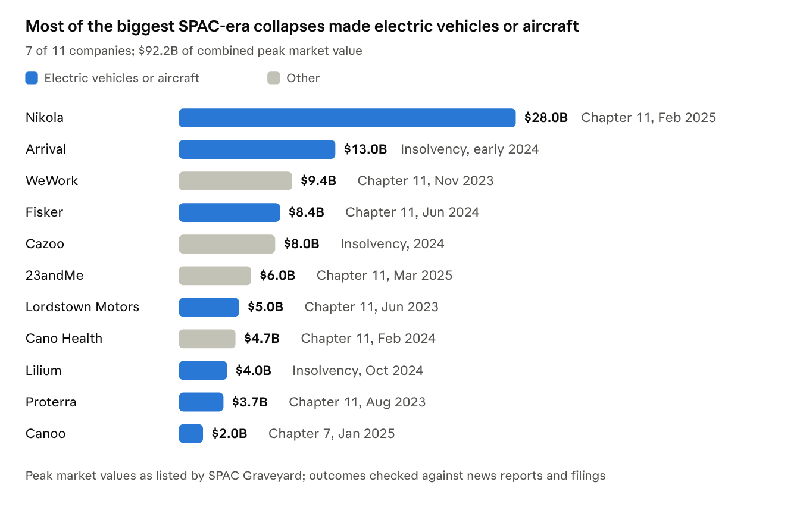

# SPAC 102: What Happened After the Mergers

*As of November 19, 2026 · Salahuddin Sirajuddin*

## Start here

**Most companies that went public by merging with a SPAC in 2020–22 lost money for the investors who held their shares.** By mid-2024, 85% of about 300 of them traded below the $10 starting price, and 79% were losing money from operations ([FTI Consulting](https://corpgov.law.harvard.edu/2024/07/29/not-even-a-raging-bull-market-can-rescue-spacs/)). A handful became big winners, and dozens went bankrupt. SPAC 102 shows what happened, why, and how to spot the next failure.

**Before you start:** this builds on [SPAC 101](../spac-101/course.md). If terms like trust, redemptions or promote are new, read parts 1, 5 and 8 there first.

**Your reading plan** (about 30 minutes):

| Part | What you will understand | Time |
|---|---|---|
| 1. Scorecard | How the 2020–22 class has performed | 4 min |
| 2. Graveyard | The biggest collapses, in one chart | 3 min |
| 3. Survivors | Which de-SPACs worked, and what they shared | 4 min |
| 4. Autopsies | Four famous failures, step by step | 6 min |
| 5. Why they failed | The causes, and who still made money | 5 min |
| 6. Has anything changed? | How 2024–26 deals are doing | 3 min |
| 7. Red flags | A checklist for the next deal you see | 3 min |
| Using SPAC Graveyard | What the site gets right and wrong | 2 min |

Short on time? Read parts 1, 2 and 7 (about 10 minutes).

## 1. The scorecard: how the 2020–22 class performed

*Time to understand: 4 minutes*

**The typical company that merged with a SPAC during the boom lost more than half its value, and most still lose money.** The boom produced more than 900 SPAC listings ([GlobalCapital](https://www.globalcapital.com/article/2azn5weeion1igf60ms5c/comment/leader/900-spacs-and-a-funeral)), and the hundreds of mergers that followed are now a large enough group to judge.

| Measure | Result | Source |
|---|---|---|
| Share of about 300 de-SPACs (merged through 2022) trading below $10 | 64% in June 2022, 80% in mid-2023, 85% in mid-2024 | [FTI Consulting](https://corpgov.law.harvard.edu/2024/07/29/not-even-a-raging-bull-market-can-rescue-spacs/) |
| Average share price, as a share of the $10 starting price | 67% in mid-2023, 50% at the end of 2023, 43% in mid-2024 | [FTI Consulting](https://www.fticonsulting.com/insights/articles/not-even-raging-bull-market-can-rescue-spacs) |
| Share losing money from operations | 83% in 2022, 79% in 2023 | [FTI Consulting](https://corpgov.law.harvard.edu/2024/07/29/not-even-a-raging-bull-market-can-rescue-spacs/) |
| De-SPACs closed since 2019 trading below $1 | More than one in five of nearly 500, in April 2024 | Bloomberg, quoted by [InvestorPlace](https://investorplace.com/2024/04/trump-media-ai-stocks-and-more-3-top-ex-spacs-to-buy-now/) |
| De-SPACs without enough cash for the next year | Almost 100, in February 2023 | [Bloomberg](https://news.bgov.com/bankruptcy-law/the-spac-fad-is-ending-in-a-pile-of-bankruptcies-and-fire-sales) |
| Bankruptcy filings | 5 in 2022, then 5 more by mid-April 2023 | [Renaissance Capital](https://www.renaissancecapital.com/IPO-Center/News/98571/five-spac-mergers-have-gone-bankrupt-this-year-tying-2022) |

**Who made money and who did not.** A 2023 study in the *Review of Financial Studies* found that SPAC IPO investors earned 23.9% a year, and sponsors more than 100% a year, between the SPAC's IPO and its merger. Public investors in the merged companies earned poor returns ([Gahng, Ritter and Zhang](https://www.ebsco.com/articles/literature-and-writing/fc5c4c6a-afe9-59da-8410-784f53000026/spacs)). In plain words: people who got in early and took their $10 back did well; people who held the merged company's shares carried the losses.

## 2. The graveyard: the biggest collapses

*Time to understand: 3 minutes*

*Source: SPAC Graveyard peak values; outcomes from news reports and filings · 11 companies, failures 2023–25*

Pandemic-era electric-vehicle makers such as Fisker, Proterra and Lordstown went bankrupt as funding dried up amid high interest rates and weak demand ([CNN](https://abc17news.com/money/cnn-business-consumer/2025/02/19/electric-truck-maker-nikola-files-for-chapter-11-bankruptcy-protection/)).

**Failures came fast.** Quanergy went from listing to bankruptcy in 10 months, Fast Radius in 9 and Enjoy in 8.5 ([Bloomberg](https://news.bgov.com/bankruptcy-law/the-spac-fad-is-ending-in-a-pile-of-bankruptcies-and-fire-sales)).

**The full list is longer.** SPAC Graveyard lists 59 entries, though some are duplicates or errors (see "Using SPAC Graveyard" near the end).

## 3. The survivors: the de-SPACs that worked

*Time to understand: 4 minutes*

**A small group of de-SPACs became big winners: mostly real businesses, or companies that later caught a hot theme.** They are the exception, and they show what the structure can do when the company is ready.

| Company | What happened | Source |
|---|---|---|
| Vertiv | The best-performing ex-SPAC: up 555% from its 2020 debut by April 2024, on demand for AI data-center power and cooling | [Bloomberg](https://www.bloomberg.com/news/articles/2024-04-08/ai-firm-is-best-performing-ex-spac-surging-past-trump-media), [FA Mag](https://www.fa-mag.com/news/ai-firm-is-best-performing-ex-spac--surging-past-trump-media-77625.html) |
| DraftKings | Rose to a peak of $74 a share in its first year as a public company, as legal sports betting spread | [Bloomberg](https://news.bgov.com/bankruptcy-law/the-spac-fad-is-ending-in-a-pile-of-bankruptcies-and-fire-sales), [InvestorPlace](https://investorplace.com/2024/04/trump-media-ai-stocks-and-more-3-top-ex-spacs-to-buy-now/) |
| SoFi, Opendoor, MP Materials | Beat Nvidia's year-to-date gain in 2025 after years of doubt; MP Materials rode demand for rare earths | [Benzinga](https://benzinga.com/z/46470320), [Webull](https://www.webull.hk/en/news/13176434921858048) |
| Hims & Hers, AST SpaceMobile | Climbed above $15 a share, joining Vertiv on SPACInsider's leaderboard of the decade's best de-SPACs | [SPACInsider](https://preview.old.spacinsider.com/?p=253563) |
| Rigetti, IonQ, D-Wave, Oklo, NuScale, Rocket Lab and others | Among 26 de-SPACs that rose more than 150% in the six months to February 2025; Rigetti rose more than 1,100% | [Renaissance Capital](https://www.renaissancecapital.com/IPO-Center/News/109492/diamonds-in-the-rough-these-26-de-spacs-have-soared-over-150-percent) |

**What the winners had in common**

- **A real business or a big theme.** Vertiv already sold data-center equipment, and DraftKings had a fast-growing market. Quantum, space and nuclear names caught investor waves years after listing.
- **Operator-led sponsors.** McKinsey found that SPACs led by former operators beat other SPACs by about 40% one year after merging, in deals from 2015 to 2019 ([Odyssey Trust](https://odysseytrust.com/insights/five-patterns-that-separate-successful-spacs/)).
- **Committed money.** Strong deals had PIPE investors with a strategic reason to invest, sponsor backstops and realistic redemption assumptions ([Odyssey Trust](https://odysseytrust.com/insights/five-patterns-that-separate-successful-spacs/)).
- **Time.** Several winners fell first and recovered years later, so one snapshot can mislead in either direction.

Prices move fast: each figure above holds for the date its source gives, not today.

## 4. Autopsies: four famous failures

*Time to understand: 6 minutes*

**Each failure followed the same arc: a big story at listing, numbers that never arrived, and cash that ran out.**

**Nikola (electric and hydrogen trucks)**

- **The deal:** went public in June 2020 by merging with VectoIQ Acquisition Corp., before it had sold a single truck. It was briefly worth about as much as Ford ([CNN](https://abc17news.com/money/cnn-business-consumer/2025/02/19/electric-truck-maker-nikola-files-for-chapter-11-bankruptcy-protection/), [Dow Jones](https://itiger.com/news/2512819489)).
- **What went wrong:** a short seller accused founder Trevor Milton of overhyping the technology. In one promotional video, the prototype truck was simply rolling down a hill ([CNN](https://daytraders.com/news/2025/02/19/ev-nikola-chapter-11-bankruptcy)). Milton was convicted of securities fraud in 2022 and sentenced to four years ([Dow Jones](https://itiger.com/news/2512819489)), then pardoned ([Elevenflo](https://elevenflo.com/blog/nikola-chapter-11-bankruptcy)). The company paid $125M to settle SEC charges ([Cooley](https://cooleypubco.com/?p=28263)).
- **The end:** filed for Chapter 11 on February 19, 2025, with about $47M of cash; the shares fell to $0.47 ([GuruFocus](https://gurufocus.com/news/2704633/nikola-shares-plunge-38-as-company-files-for-chapter-11-bankruptcy-plans-asset-sale)).
- **Lesson:** a pre-revenue company's story is not a business. Check every claim against evidence.

**WeWork (shared offices)**

- **The deal:** after a failed IPO in 2019, it went public in October 2021 by merging with BowX Acquisition Corp., at a $9B valuation ([Quartz](https://qz.com/things-are-not-working-out-for-wework-1850997956), [Fortune](https://fortune.com/2023/11/07/wework-spac-bankruptcy-chapter-11-core-scientific-virgin-orbit/)).
- **What went wrong:** losses kept mounting. By August 2023 it warned about its ability to keep operating and did a 1-for-40 reverse split to stay listed ([Caproasia](https://www.caproasia.com/?p=37917)).
- **The end:** filed for Chapter 11 on November 6, 2023, with about $4B of debt and $164M of cash ([Caproasia](https://www.caproasia.com/?p=38194)). It emerged debt-free in June 2024 ([Elevenflo](https://elevenflo.com/blog/wework-bankruptcy-debt-free-emergence)).
- **Lesson:** a SPAC can be a second try after a failed IPO. Ask why the first try failed.

**23andMe (consumer DNA tests)**

- **The deal:** went public in June 2021 by merging with VG Acquisition Corp., a SPAC sponsored by Richard Branson's Virgin Group, at a value of $3.5B ([Debtwire](https://ionanalytics.com/insights/debtwire/human-genetics-and-biotechnology-company-23andme-to-pursue-bankruptcy-sale-after-failed-prepetition-attempt-case-profile/)). It later peaked at about $6B ([Elevenflo](https://www.elevenflo.com/blog/23andme-chapter-11-deep-dive-35m-dip-financing-asset-sale-dynamics-and-privacy-scrutiny)).
- **What went wrong:** most customers bought one kit and never came back, and a 2023 data breach hurt trust. In 2024 it lost $681M on $192M of sales ([SiliconANGLE](https://siliconangle.com/2025/03/24/valued-3-5b-23andme-files-chapter-11-bankruptcy/), [Fortune](https://fortune.com/2025/07/01/23andme-sale-ceo-anne-wojcicki-dna-test-health/)).
- **The end:** filed for Chapter 11 on March 23, 2025. Co-founder Anne Wojcicki's nonprofit, TTAM, bought the business for $305M, beating Regeneron's $256M bid ([MarketBeat](https://www.marketbeat.com/articles/23andmes-former-ceo-anne-wojcicki-just-regained-control-of-the-company-she-cofounded-heres-how-2025-06-16)).
- **Lesson:** a one-time product does not support a valuation built on repeat revenue.

**Lordstown Motors (electric pickups)**

- **The deal:** went public in October 2020 by merging with DiamondPeak Holdings, raising more than $675M ([Benzinga](https://www.inkl.com/news/broken-ev-dreams-lordstown-s-bankruptcy-and-10m-investor-settlement), [SEC](https://www.sec.gov/files/litigation/complaints/2024/comp25954.pdf)).
- **What went wrong:** it claimed about 100,000 pre-orders for its Endurance pickup. In March 2021, Hindenburg Research said those pre-orders were misleading ([Benzinga](https://benzinga.com/z/42204940)). The SEC later charged the company, which agreed to pay $25.5M ([Benzinga](https://www.inkl.com/news/broken-ev-dreams-lordstown-s-bankruptcy-and-10m-investor-settlement)). Its founder and former CEO sold shares worth more than $66.8M ([Business Journal Daily](https://businessjournaldaily.com/?p=199600)).
- **The end:** filed for Chapter 11 on June 27, 2023, and emerged in March 2024 as Nu Ride ([SEC](https://www.sec.gov/files/litigation/complaints/2024/comp25954.pdf)).
- **Lesson:** pre-orders are not sales. Ask for signed contracts and deposits.

## 5. Why so many failed, and who still made money

*Time to understand: 5 minutes*

**Most failures came from the same mix: young companies, rosy forecasts, and cash that drained away before the business could stand on its own.** The SPAC structure made each of these worse.

| Cause | What happened | Evidence |
|---|---|---|
| Companies that were not ready | Many targets were late-stage startups, not profitable companies ready for an IPO | [FTI Consulting](https://www.fticonsulting.com/insights/articles/not-even-raging-bull-market-can-rescue-spacs) |
| Too much money, too few good targets | Hundreds of SPACs chased a short list of suitable companies, and many did deals anyway | [FTI Consulting](https://www.fticonsulting.com/insights/articles/not-even-raging-bull-market-can-rescue-spacs) |
| Forecasts that never came true | Pear Therapeutics showed explosive growth forecasts, missed them, and filed for bankruptcy in April 2023 | [Renaissance Capital](https://www.renaissancecapital.com/IPO-Center/News/98571/five-spac-mergers-have-gone-bankrupt-this-year-tying-2022) |
| Costs and redemptions drained the cash | Merging with a SPAC cost a median 15.1% of the company's post-merger value, against 3.2% for a traditional IPO | [Gahng, Ritter and Zhang](https://www.ebsco.com/articles/literature-and-writing/fc5c4c6a-afe9-59da-8410-784f53000026/spacs) |
| Money got expensive | The mania ended in mid-2022 as the Fed raised rates, and funding for cash-hungry companies dried up | [FTI Consulting](https://www.fticonsulting.com/insights/articles/not-even-raging-bull-market-can-rescue-spacs), [CNN](https://abc17news.com/money/cnn-business-consumer/2025/02/19/electric-truck-maker-nikola-files-for-chapter-11-bankruptcy-protection/) |
| Hype and fraud | The SEC settled with Nikola for $125M, Hyzon for $25M and XL Fleet's successor for $11M over misleading investors | [Cooley](https://cooleypubco.com/?p=28263) |

**Who still made money**

- **Sponsors.** They typically get a 20% stake and have little to lose if the deal disappoints ([FTI Consulting](https://www.fticonsulting.com/insights/articles/not-even-raging-bull-market-can-rescue-spacs)). On average they earned more than 100% a year before the merger ([Gahng, Ritter and Zhang](https://www.ebsco.com/articles/literature-and-writing/fc5c4c6a-afe9-59da-8410-784f53000026/spacs)).
- **Early SPAC investors.** Those who bought at the SPAC's IPO earned 23.9% a year on average up to the merger, because they could take their money back ([Gahng, Ritter and Zhang](https://www.ebsco.com/articles/literature-and-writing/fc5c4c6a-afe9-59da-8410-784f53000026/spacs)).
- **Banks and advisors.** Underwriting fees are paid whether or not the merged company succeeds (part 8 of SPAC 101).
- **Insiders who sold early.** Lordstown's founder sold shares worth more than $66.8M before the company failed (part 4).

The losses fell on the investors who bought or kept the merged company's shares.

## 6. Has anything changed? How 2024–26 deals are doing

*Time to understand: 3 minutes*

**The market is healthier, but shareholders still mostly lose: most new de-SPACs trade below $10 soon after closing.** The 2024 rules brought more disclosure, and far fewer SPACs now fail to find a deal, yet post-merger trading has barely improved.

| Measure | Result | Source |
|---|---|---|
| 2024's de-SPAC mergers trading above $10, by February 2025 | Fewer than 10% | [Renaissance Capital](https://www.renaissancecapital.com/IPO-Center/News/109492/diamonds-in-the-rough-these-26-de-spacs-have-soared-over-150-percent) |
| De-SPACs closed in the 12 months to May 2026 trading below $10 | 30 of 38 (79%); 29% were below $2 | [Boardroom Alpha](https://cms.boardroomalpha.com/?p=19562) |
| Hard-tech de-SPACs closed since January 2025 trading below $10, by November 2026 | 16 of 17, with a median loss of 59% | [IPO Club](https://www.ipo.club/blog/spac-vs-ipo-hard-tech-2026), an investment firm's blog |
| Redemptions at closing | 91.5% in Q2 2026 | [Houlihan Capital](https://www.houlihancapital.com/wp-content/uploads/2026/08/Q2-2026-SPAC-Report.pdf) |
| SPACs liquidated without a deal | 10 in 2025, down from 53 in 2024 | [Boardroom Alpha](https://www.boardroomalpha.com/research/daily-spac-update-december-31-2025) |

**Recent examples.** Kodiak AI listed at a $2.5B valuation in September 2025 and was later worth about $1.4B ([Morningstar](https://www.morningstar.com/markets/spac-market-shows-signs-life)). Two crypto-treasury deals that closed in December 2025 also slid: Twenty One Capital traded under $6 and ProCap Financial around $2.39 ([Institutional Investor](https://www.institutionalinvestor.com/article/bitcoin-treasury-spac-market-dead)).

**What is different now:** results vary more by sector ([Houlihan Capital](https://www.houlihancapital.com/industry-intelligence-hub/spac-market-intelligence/)), and today's hot themes, such as AI, quantum computing and crypto, draw the kind of excitement electric vehicles drew in 2020–21 ([Morningstar](https://www.morningstar.com/markets/spac-market-shows-signs-life)).

## 7. Lessons: a red-flag checklist

*Time to understand: 3 minutes*

**No single sign predicts failure, but each of these showed up again and again in the graveyard.** Use the list when you look at any SPAC deal: the more boxes a deal ticks, the more careful you should be.

| Red flag | Why it matters | Where to check |
|---|---|---|
| Little or no revenue, big forecasts | Most de-SPAC bankruptcies were young tech or biotech companies that needed more capital ([Skadden](https://www.skadden.com/insights/publications/2023/04/quarterly-insights/as-spac-boom-subsides)); Pear missed its forecasts (part 5) | The projections in the S-4 or proxy |
| "Pre-orders" or a "pipeline" instead of sales | Lordstown's 100,000 pre-orders were misleading (part 4) | Compare the investor deck with revenue in 10-Q filings |
| Redemptions above 90% and a small PIPE | Little of the trust cash reaches the company (part 6) | The closing 8-K and redemption results |
| Net cash per share well under $10 | The promote, warrants and fees dilute every share (SPAC 101, part 8) | The dilution table in the S-4 |
| A sponsor with no operating experience | Operator-led SPACs did about 40% better a year after merging (part 3) | The sponsor section of the S-4 |
| A hot theme of the moment | Electric vehicles in 2020–21 and crypto treasuries in 2025 produced many failures (parts 2 and 6) | Headlines, and how many SPACs chase the same theme |
| A valuation cut before closing | Terms are reset when investors push back (Einride, SPAC 101 part 9) | Amended merger filings |
| Trading below $10 in the first week | New public investors already doubt the price (part 6) | The share price after closing |
| A going-concern warning | The company may run out of cash within a year (WeWork, part 4) | "Substantial doubt" language in the 10-K or 10-Q |
| Insiders selling as lock-ups end | Founders can cash out before results arrive (Lordstown, part 4) | Form 4 filings |

**The one-line version:** judge a de-SPAC like an IPO, not a lottery ticket. Look for real revenue, real cash and a sponsor who has run a business.

## Using SPAC Graveyard: what it gets right and wrong

*Time to understand: 2 minutes*

**SPAC Graveyard is a useful starting list, not a source of record.** It tracks about 1,320 SPACs, publishes case studies ("autopsies") and screening tools, and draws on SEC filings, market data and academic research ([SPAC Graveyard](https://www.spacgraveyard.com/)). Its best headline figures trace back to solid studies such as FTI's. But it is run by TheDataProject.ai, names no authors, and its numbers need checking:

- Its "59 bankruptcies" count repeats some companies (IronNet three times; Virgin Orbit and Enjoy twice) and includes firms that never failed ([graveyard list](https://www.spacgraveyard.com/graveyard)).
- Landsea Homes was bought for $11.30 a share in cash in June 2025 ([8-K](https://www.sec.gov/Archives/edgar/data/1721386/000114036125023577/ef20050919_ex99-1.htm)). Eos Energy is still listed, ended 2025 with $625M of cash ([Eos](https://investors.eose.com/news-releases/news-release-details/eos-energy-enterprises-reports-fourth-quarter-and-full-year-2025/)), and even appears on Renaissance Capital's list of de-SPAC winners (part 3).
- The SunPower on its list is the solar company founded in 1985, not a de-SPAC. Complete Solaria, a de-SPAC, later bought its assets and its name ([EnergySage](https://www.energysage.com/solar/sunpower-is-bankrupt-what-now/)).
- Its headline totals disagree: money raised shows as both $363B and $250B, and value destroyed as both $131B and about $170B.
- Its average return (−55% on the home page, −62% on the methodology page) is a simple average of a hand-picked sample ([methodology](https://www.spacgraveyard.com/methodology)).

**How to use it:** take names and leads from it, take headline numbers from studies like FTI's, and check any single company in its own SEC filings.

## Sources

**Performance studies and data**

- [FTI Consulting, "Not Even a Raging Bull Market Can Rescue SPACs" (July 2024)](https://www.fticonsulting.com/insights/articles/not-even-raging-bull-market-can-rescue-spacs), also on the [Harvard Law School Forum](https://corpgov.law.harvard.edu/2024/07/29/not-even-a-raging-bull-market-can-rescue-spacs/)
- [Gahng, Ritter and Zhang, "SPACs", Review of Financial Studies (2023)](https://www.ebsco.com/articles/literature-and-writing/fc5c4c6a-afe9-59da-8410-784f53000026/spacs)
- Renaissance Capital on [de-SPAC bankruptcies (April 2023)](https://www.renaissancecapital.com/IPO-Center/News/98571/five-spac-mergers-have-gone-bankrupt-this-year-tying-2022) and [de-SPAC winners (February 2025)](https://www.renaissancecapital.com/IPO-Center/News/109492/diamonds-in-the-rough-these-26-de-spacs-have-soared-over-150-percent)
- [Bloomberg, "The SPAC Fad Is Ending in a Pile of Bankruptcies and Fire Sales" (February 2023)](https://news.bgov.com/bankruptcy-law/the-spac-fad-is-ending-in-a-pile-of-bankruptcies-and-fire-sales)
- [InvestorPlace, quoting Bloomberg on de-SPACs below $1 (April 2024)](https://investorplace.com/2024/04/trump-media-ai-stocks-and-more-3-top-ex-spacs-to-buy-now/)
- [Skadden on de-SPACed companies in Chapter 11 (April 2023)](https://www.skadden.com/insights/publications/2023/04/quarterly-insights/as-spac-boom-subsides)
- [GlobalCapital, "900 Spacs and a funeral"](https://www.globalcapital.com/article/2azn5weeion1igf60ms5c/comment/leader/900-spacs-and-a-funeral)
- Boardroom Alpha [de-SPAC tracker (May 2026)](https://cms.boardroomalpha.com/?p=19562) and [2025 year-end update](https://www.boardroomalpha.com/research/daily-spac-update-december-31-2025)
- Houlihan Capital [Q2 2026 SPAC Report](https://www.houlihancapital.com/wp-content/uploads/2026/08/Q2-2026-SPAC-Report.pdf) and [market intelligence](https://www.houlihancapital.com/industry-intelligence-hub/spac-market-intelligence/)
- [IPO Club on hard-tech de-SPAC returns (2026)](https://www.ipo.club/blog/spac-vs-ipo-hard-tech-2026)

**Survivors**

- [Bloomberg on Vertiv (April 2024)](https://www.bloomberg.com/news/articles/2024-04-08/ai-firm-is-best-performing-ex-spac-surging-past-trump-media) and [FA Mag](https://www.fa-mag.com/news/ai-firm-is-best-performing-ex-spac--surging-past-trump-media-77625.html)
- [Benzinga on SoFi, Opendoor and MP Materials (2025)](https://benzinga.com/z/46470320) and [Webull](https://www.webull.hk/en/news/13176434921858048)
- [SPACInsider de-SPAC leaderboard](https://preview.old.spacinsider.com/?p=253563)
- [Odyssey Trust, "Five patterns that separate successful SPACs"](https://odysseytrust.com/insights/five-patterns-that-separate-successful-spacs/)

**Autopsies**

- Nikola: [Dow Jones](https://itiger.com/news/2512819489), [CNN](https://abc17news.com/money/cnn-business-consumer/2025/02/19/electric-truck-maker-nikola-files-for-chapter-11-bankruptcy-protection/), [CNN on the prototype video](https://daytraders.com/news/2025/02/19/ev-nikola-chapter-11-bankruptcy), [GuruFocus](https://gurufocus.com/news/2704633/nikola-shares-plunge-38-as-company-files-for-chapter-11-bankruptcy-plans-asset-sale), [Elevenflo](https://elevenflo.com/blog/nikola-chapter-11-bankruptcy), [Cooley](https://cooleypubco.com/?p=28263)
- WeWork: [Quartz](https://qz.com/things-are-not-working-out-for-wework-1850997956), [Fortune](https://fortune.com/2023/11/07/wework-spac-bankruptcy-chapter-11-core-scientific-virgin-orbit/), [Caproasia, August 2023](https://www.caproasia.com/?p=37917), [Caproasia, November 2023](https://www.caproasia.com/?p=38194), [Elevenflo](https://elevenflo.com/blog/wework-bankruptcy-debt-free-emergence)
- 23andMe: [Debtwire](https://ionanalytics.com/insights/debtwire/human-genetics-and-biotechnology-company-23andme-to-pursue-bankruptcy-sale-after-failed-prepetition-attempt-case-profile/), [Elevenflo](https://www.elevenflo.com/blog/23andme-chapter-11-deep-dive-35m-dip-financing-asset-sale-dynamics-and-privacy-scrutiny), [SiliconANGLE](https://siliconangle.com/2025/03/24/valued-3-5b-23andme-files-chapter-11-bankruptcy/), [Fortune](https://fortune.com/2025/07/01/23andme-sale-ceo-anne-wojcicki-dna-test-health/), [MarketBeat](https://www.marketbeat.com/articles/23andmes-former-ceo-anne-wojcicki-just-regained-control-of-the-company-she-cofounded-heres-how-2025-06-16)
- Lordstown Motors: [SEC complaint](https://www.sec.gov/files/litigation/complaints/2024/comp25954.pdf), [Benzinga](https://benzinga.com/z/42204940), [Benzinga via inkl](https://www.inkl.com/news/broken-ev-dreams-lordstown-s-bankruptcy-and-10m-investor-settlement), [Business Journal Daily](https://businessjournaldaily.com/?p=199600)

**Recent deals**

- [Morningstar on the SPAC revival](https://www.morningstar.com/markets/spac-market-shows-signs-life)
- [Institutional Investor on crypto-treasury SPACs](https://www.institutionalinvestor.com/article/bitcoin-treasury-spac-market-dead)

**SPAC Graveyard, and checks on it**

- [SPAC Graveyard](https://www.spacgraveyard.com/): [graveyard list](https://www.spacgraveyard.com/graveyard), [methodology](https://www.spacgraveyard.com/methodology)
- [Landsea Homes 8-K, June 2025](https://www.sec.gov/Archives/edgar/data/1721386/000114036125023577/ef20050919_ex99-1.htm); [Eos Energy 2025 results](https://investors.eose.com/news-releases/news-release-details/eos-energy-enterprises-reports-fourth-quarter-and-full-year-2025/); [EnergySage on SunPower](https://www.energysage.com/solar/sunpower-is-bankrupt-what-now/)
